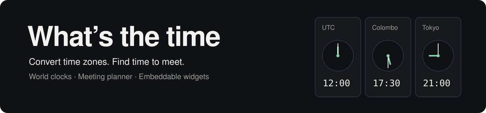

# What's the time | whatsthetime.top

<div align="center">

<picture>
  <source media="(prefers-color-scheme: dark)" srcset="docs/assets/banner-dark.svg">
  <source media="(prefers-color-scheme: light)" srcset="docs/assets/banner-light.svg">
  
</picture>

[](package.json)
[](src/components/MeetingPlanner.jsx)
[](tailwind.config.cjs)

**[Open the site](https://whatsthetime.top)** · **[Tools](#tools)** · **[Run locally](#run-locally)** · **[Project map](#project-map)**

</div>

A time zone converter, world clock, and international meeting planner for people
working across cities. Use the [public website](https://whatsthetime.top) without
creating an account, or run this Astro site locally to work on the code.

## Tools

| Tool | What you can do |
| --- | --- |
| [Time converter](https://whatsthetime.top/) | Search time zones, convert a selected time, and copy a conversion link. |
| [Meeting planner](https://whatsthetime.top/meeting-planner) | Compare participants' working hours, pick a slot, and export an `.ics` event or open Google Calendar. |
| [Popular comparisons](https://whatsthetime.top/popular) | Browse generated city-to-city time comparison pages. |
| [Embeddable converter](https://whatsthetime.top/embed) | Add the converter to another website with an iframe. |
| [Embeddable planner](https://whatsthetime.top/metEmbed) | Add the meeting planner to another website. |
| [Blog](https://whatsthetime.top/blog) | Read guides on time zones, remote work, and scheduling. |

Time calculations use IANA zone identifiers and Luxon. The meeting planner
uses the selected date when converting time zones, including daylight saving offsets.

## Run locally

Use a current **Node.js 22 LTS** installation with **npm** and **Git**. This is a
recommended development setup; the project does not declare an exact minimum Node version.

```bash
git clone https://github.com/thekusaldarshana/whatsthetime.git
cd whatsthetime
npm ci
npm run dev
```

Open the local URL Astro prints in the terminal. Start at the converter, then
visit `/meeting-planner` to try participant working hours and calendar export.

| Command | Purpose |
| --- | --- |
| `npm run dev` | Start the Astro development server. |
| `npm run build` | Generate the production site in `dist/`. |
| `npm run preview` | Serve the production build locally, after building. |
| `npm run astro -- --help` | Show the Astro CLI commands. |

## Embed a tool

Use the hosted tool as the iframe source. Adjust the dimensions for your page.

```html
<iframe
  src="https://whatsthetime.top/embed"
  title="Time zone converter"
  width="100%"
  height="700"
  loading="lazy">
</iframe>
```

Use `https://whatsthetime.top/metEmbed` for the meeting planner instead.

## Project map

| Path | Purpose |
| --- | --- |
| [`src/pages/`](src/pages/) | Converter, planner, embeds, blog, and generated comparison routes. |
| [`src/components/`](src/components/) | Converter UI, React meeting planner, clocks, and shared components. |
| [`src/content/blog/`](src/content/blog/) | Markdown posts and article media. |
| [`src/lib/`](src/lib/) | City metadata, aliases, comparison pairs, and shared helpers. |
| [`public/zones.json`](public/zones.json) | Time zone search data served to the browser. |
| [`astro.config.mjs`](astro.config.mjs) | React, Tailwind, sitemap, and canonical site configuration. |

To change the canonical domain, update `site` in `astro.config.mjs` and review
the URLs in the page metadata, embed examples, and public discovery files.
The page layouts also contain analytics and advertising integrations; review
those integrations before deploying your own copy.

## Troubleshooting

| Symptom | What to check |
| --- | --- |
| `astro` is not found | Run `npm ci` from the repository root. |
| A browser tool loads without working time controls | Check the browser console and network access: some browser modules are loaded from a CDN. |
| A shared link shows the wrong city | Use a zone offered by the search list and check its IANA identifier. |
| A converted time differs around a clock change | Check the selected date and both zones' daylight saving offsets. |
| `preview` has no site to serve | Run `npm run build` first. |

## Contributing and reuse

Report a bug or suggest a change through
[GitHub issues](https://github.com/thekusaldarshana/whatsthetime/issues).
Include the affected route, selected date and zones, and browser when reporting
a conversion problem. The repository does not currently include a project
license file; check with the owner before redistributing its code or assets.
