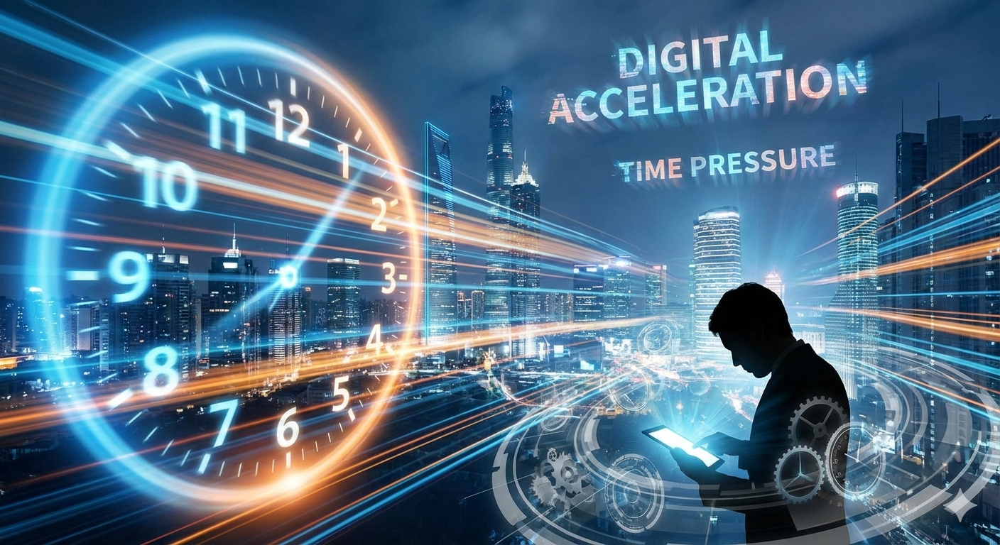
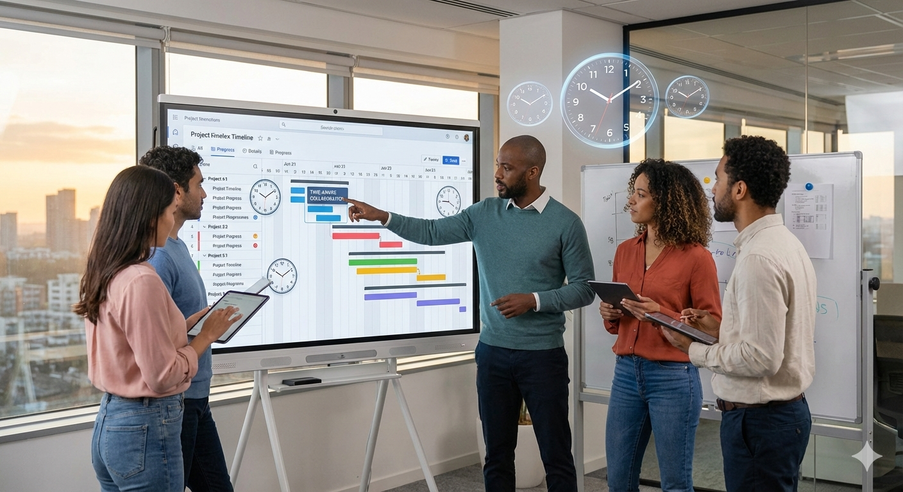

A new year doesn’t just bring new goals — it brings a **new relationship with time**.

As we step into 2026, one thing is clear: time feels faster, more fragmented, and more valuable than ever before. Work spans continents. Teams live in different time zones. AI schedules meetings. Notifications never sleep.

And yet, paradoxically, we’ve never had **more tools to control time** than we do now.

This first What’s The Time blog of 2026 explores a simple but powerful question:

**How is time changing — and how should we adapt?**

---

## The Acceleration Effect: Why Time Feels Faster in 2026

People across the world report the same feeling:  
Days blur together. Weeks vanish. Months disappear.

This isn’t imagination. It’s what researchers call the **Acceleration Effect** — caused by:

- Constant digital context switching
- Always-on global communication
- Shorter feedback loops
- Algorithm-driven urgency

When your phone connects you to five time zones instantly, your brain never truly clocks out.

Time hasn’t changed — **our exposure to it has**.

---

---

## Work No Longer Runs on a Clock — It Runs on Outcomes

In 2026, the traditional 9–5 workday is officially obsolete for knowledge workers.

Instead, companies are shifting toward:

- Output-based performance
- Async-first collaboration
- Flexible work cycles instead of fixed hours

This means people work when their **energy peaks**, not when the clock demands it.

Time is no longer about *presence*.  
It’s about *progress*.

---

## Global Teams, Global Time Conflicts

Remote work didn’t reduce time complexity — it amplified it.

A single project may involve:

- A designer in Europe
- A developer in South Asia
- A manager in North America
- A client in Australia

Suddenly, scheduling a “simple meeting” becomes a puzzle involving daylight saving changes, half-hour offsets, and human fatigue.

This is why tools like the **Time Converter** on [What’s The Time](/) are no longer “nice to have” — they’re survival tools.

---

## AI Is Quietly Taking Over Scheduling

One of the biggest shifts in 2026 is invisible: **humans are no longer doing the math**.

AI-powered scheduling systems now:

- Detect time zones automatically
- Respect personal working hours
- Avoid burnout-prone hours
- Optimize overlap fairly

Instead of asking *“When are you free?”*, teams ask *“What’s the best time for everyone?”*

That’s where tools like the **[Meeting Planner](/meeting-planner)** come in — removing friction before it becomes frustration.

---

<iframe src='https://whatsthetime.online/metEmbed' width='100%' height='500' style='border:none;' loading='lazy'></iframe>

---

<ins class="adsbygoogle"
     style="display:block; text-align:center;"
     data-ad-layout="in-article"
     data-ad-format="fluid"
     data-ad-client="ca-pub-6381695271630022"
     data-ad-slot="2167329849"></ins>

---

## The Rise of Time Awareness as a Skill

In 2026, time literacy is becoming a **core professional skill**.

High-performing teams excel at:

- Knowing when *not* to meet
- Communicating asynchronously
- Respecting time boundaries across cultures
- Designing workflows that move while people sleep

Time awareness now sits alongside communication and problem-solving as a career-defining ability.

---

---

## Async Is No Longer Optional

Synchronous work doesn’t scale globally. Async does.

That’s why modern teams rely on:

- Recorded updates instead of live meetings
- Written decisions instead of verbal ones
- Shared dashboards instead of status calls

Async isn’t about avoiding people.  
It’s about **giving time back to them**.

When done right, async work reduces stress, improves clarity, and makes time zones almost irrelevant.

---

## Time Zones Aren’t the Enemy — Bad Systems Are

Time zones are neutral. They’re a fact of physics.

What causes pain is:

- Poor planning
- Lack of visibility
- One-sided scheduling
- Ignoring human biology

When teams use proper tools and fair policies, time zones turn into an advantage — enabling round-the-clock progress without burnout.

---

<ins class="adsbygoogle"
     style="display:block; text-align:center;"
     data-ad-layout="in-article"
     data-ad-format="fluid"
     data-ad-client="ca-pub-6381695271630022"
     data-ad-slot="2167329849"></ins>

---

## A Subtle Shift: People Are Protecting Time Again

After years of hustle culture, something changed.

In late 2025 and into 2026, more people began:

- Blocking calendars intentionally
- Declining unnecessary meetings
- Logging off without guilt
- Measuring work in impact, not hours

Time is being reclaimed — not optimized.

This cultural shift matters more than any tool.

---

---

## What 2026 Demands From Us

This year demands a new mindset:

- Be intentional with meetings
- Respect unseen time zones
- Design systems that move without constant presence
- Treat time as a shared resource, not a personal weapon

The future belongs to those who **coordinate time well**, not those who dominate it.

---

## Why What’s The Time Exists

What’s The Time isn’t just a website.  
It’s a response to a world that forgot how complex time really is.

From the **Time Converter** to the **Global Meeting Planner**, our goal is simple:

👉 Reduce confusion  
👉 Increase fairness  
👉 Give people their time back  

Because in 2026, time isn’t money.  
**Time is life.**

---

<ins class="adsbygoogle"
     style="display:block; text-align:center;"
     data-ad-layout="in-article"
     data-ad-format="fluid"
     data-ad-client="ca-pub-6381695271630022"
     data-ad-slot="2167329849"></ins>

---

## Final Thoughts: Start 2026 With Better Time

This year will move fast.  
But it doesn’t have to move **carelessly**.

Whether you’re planning meetings, working remotely, or coordinating across continents — start with awareness.

And when time gets confusing, you know where to look.

Welcome to 2026.  
Let’s use time wisely.

