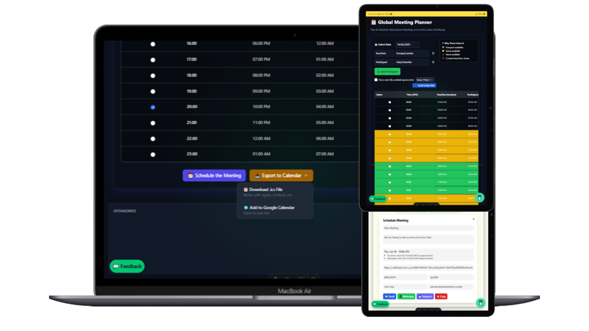

We’re excited to introduce a new tool to the What's The Time family!

Plan international meetings like a pro — no time zone math, no guesswork.

### ✅ Features:
- Convert meeting time instantly across any participant's location
- Clean and mobile-first interface
- One-click “Copy Meeting Details” button
- Fully free, no login needed

---

### 🔗 Try it Now  
👉 [whatsthetime.top/meeting-planner](https://whatsthetime.top/meeting-planner)

<iframe src='https://whatsthetime.top/metEmbed' width='100%' height='700' style='border:none;' loading='lazy'></iframe>
---

Whether you're a remote team, a digital nomad, or a global citizen — this tool is built for you. It's fast, intuitive, and elegant.

More tools are coming soon to make time simple again ✨  
Stay tuned, and thank you for the support 💛

– The What's The Time Team ⏱️
